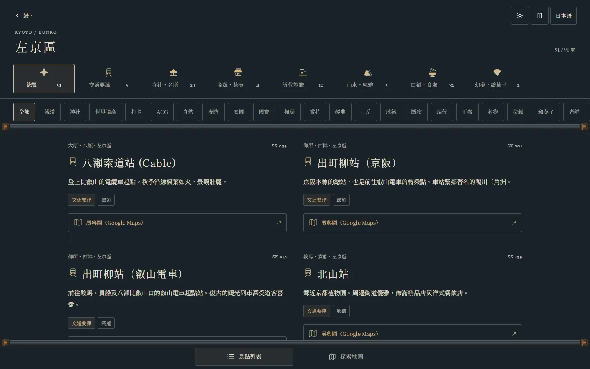
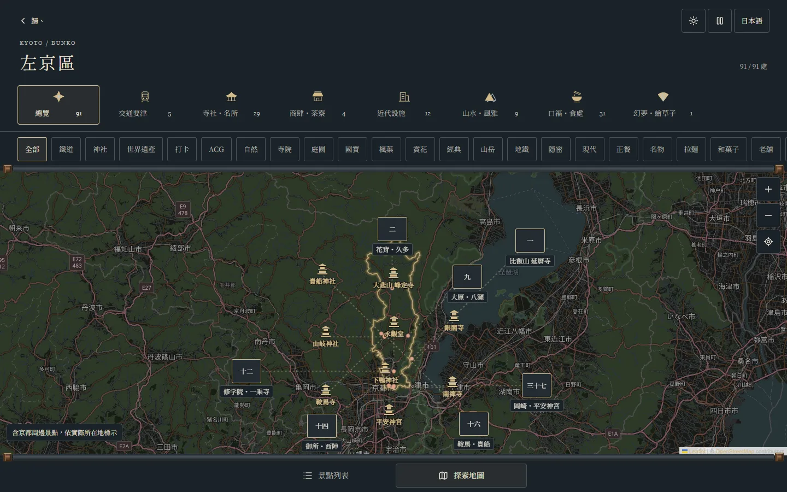
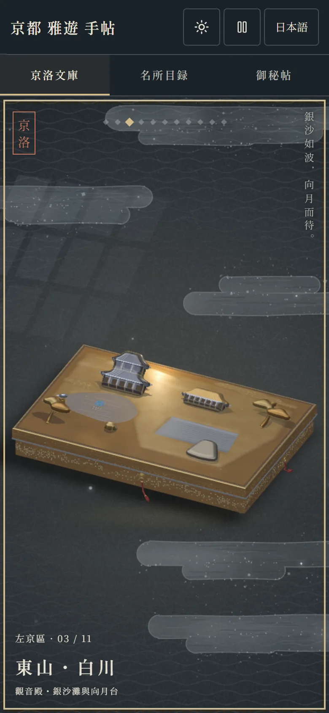
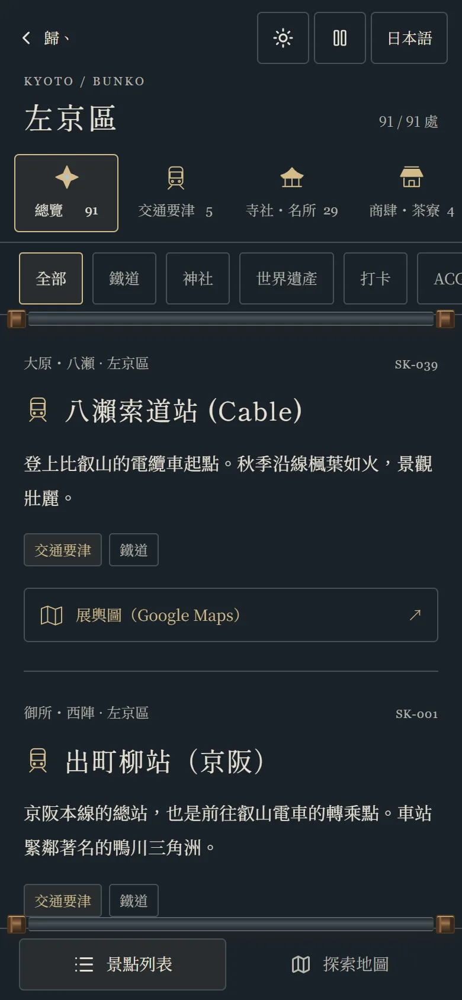

<div align="center">

# Kyoto Bunko 京洛文庫

**漆の文箱に収めた京都案内 ― 十一区、十一函、809 か所。**

[English](README.md) · [繁體中文](README.zh-TW.md) · 日本語

[**サイトを開く →**](https://avalon-ash.github.io/Kyoto-Bunko/)


</div>

京洛文庫は、京都の観光案内を漆塗りの文箱の棚に仕立てたものです。京都市の十一の行政区にそれぞれ一函。蓋にはその区の名所が蒔絵のレリーフとして描かれ、WebGL2 でリアルタイムに描画されます。蓋を撫でれば金が光を受け、左右にドラッグすれば次の函へ。蓋を開ければ、その区の名所の巻物が広がります。

画面の言語は日本語と繁体字中国語です。

## 三つの入口

| | |
|---|---|
| **京洛文庫** | 一区一函。蓋を開けて巻を読む：種別とタグで絞り込み、カードか地図で見る。 |
| **名所目録** | 嵐山、祇園・清水、金閣寺周辺など 19 の散策エリア。行政区より細かく、一日の行程づくりに。 |
| **御秘帖** | 区をまたぐテーマ索引：抹茶、ラーメン、世界遺産、紅葉、隠れた老舗、聖地巡礼。 |

どの名所もワンタップで Google マップを開けます。

<table>
<tr>
<td width="50%"></td>
<td width="50%"></td>
</tr>
<tr>
<td>蓋を開ける</td>
<td>昼のテーマ・北区の金閣</td>
</tr>
<tr>
<td></td>
<td></td>
</tr>
<tr>
<td>区の巻：種別 → タグ → カード</td>
<td>同じ名所を地図で</td>
</tr>
</table>

<p align="center">

&nbsp;

</p>

## 特長

- **十一函の蒔絵。** 区ごとに構図したレリーフ。見てわかる大きな形は立体に、細部は切金・切銀・青貝の平らな象嵌で表しています。光は指やカーソルについて動き、光が当たると部品が立ち上がります。
- **月明かり／昼の二つのテーマ**と言語切り替え。動きを減らす設定では部品がすべて伏せ、光だけが手に従います。
- **809 か所の名所**を七種に分類：交通、社寺・名所、商店・茶寮、近代施設、山水・風雅、食処、アニメ・ゲームの聖地。食処は追加・変更のたびに食べログで確認しています。
- **スマートフォン優先。** 一本指で光をなで、スワイプで函を替え、ピンチで拡大。キーボード操作（矢印、Enter、`+`／`−`）にも対応。

## ローカルで動かす

```bash
npm install
npm run dev        # http://127.0.0.1:3000
```

CI がデプロイ前に実行するチェック：

```bash
npm run lint && npx --no-install tsx validate_data.js --strict && npm test && npm run build
```

React 19、Vite、TypeScript、Tailwind CSS 4、Leaflet、素の WebGL2 で作っています。3D エンジンは使っていません。

## 開発に参加する

- [開発ドキュメント](docs/DEVELOPMENT.md)（中国語）：構成、データスキーマ、タグ登録、データ入力の規則
- [現在の状況と引き継ぎ](docs/HANDOFF.md)（中国語）
- [エージェント実行規約](AGENTS.md)（中国語）

## クレジット

行政区界と地図タイル © [OpenStreetMap](https://www.openstreetmap.org/copyright) contributors（ODbL 1.0）。書体：Shippori Mincho B1、Noto Serif TC、Noto Serif JP（Google Fonts）。

文箱は写意の蒔絵構図であり、正確な建築の復元や道案内の地図ではありません。
