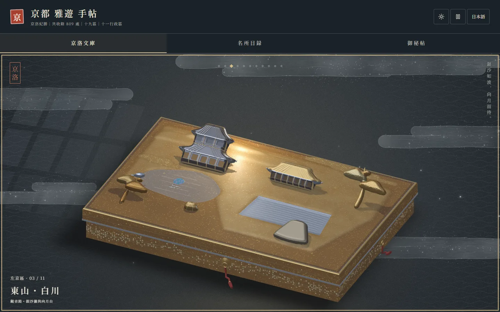
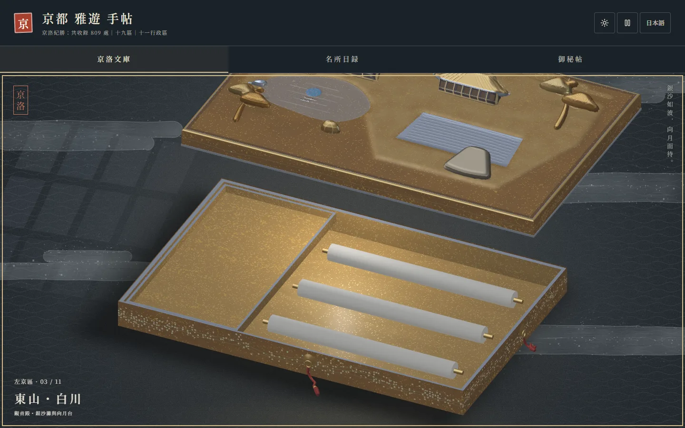
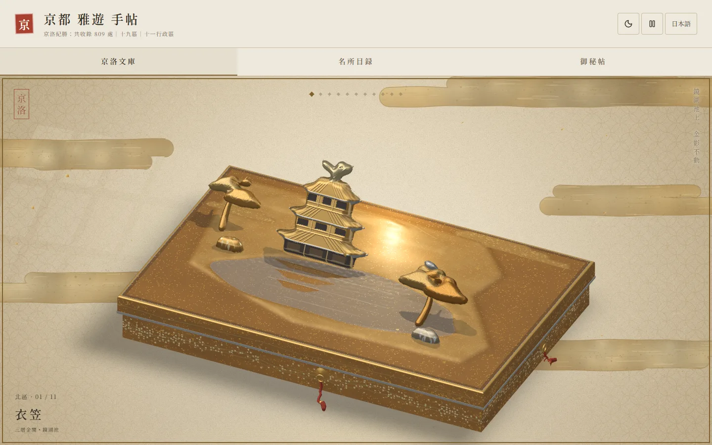
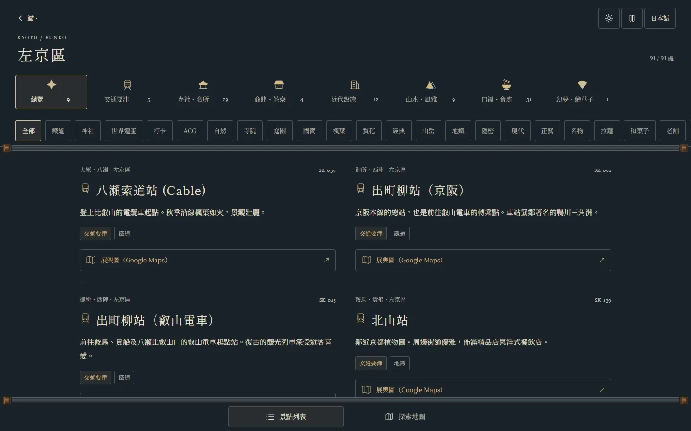
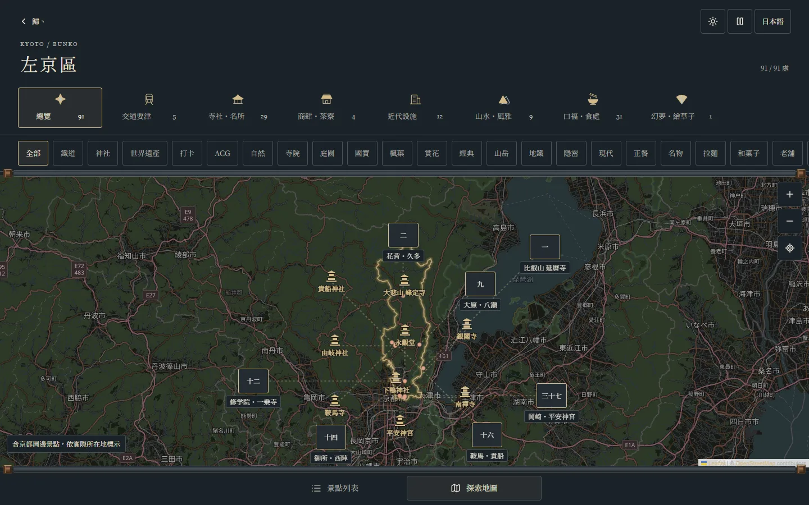
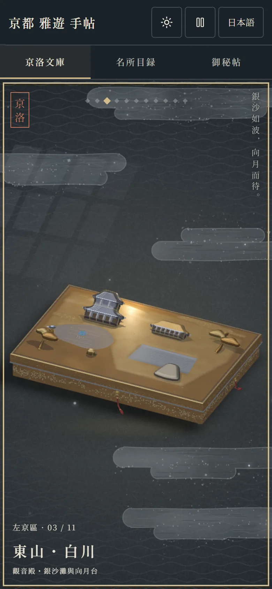
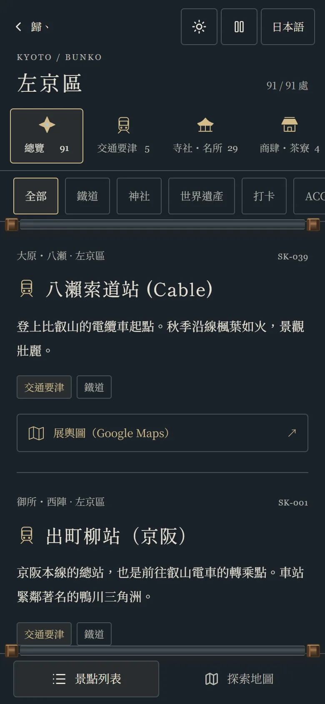

<div align="center">

# Kyoto Bunko 京洛文庫

**A lacquer-box guide to Kyoto — eleven wards, eleven boxes, 809 places.**

English · [繁體中文](README.zh-TW.md) · [日本語](README.ja.md)

[**Open the site →**](https://avalon-ash.github.io/Kyoto-Bunko/)



</div>

Kyoto Bunko turns a Kyoto travel index into a shelf of lacquered document boxes. Each of the city's eleven wards gets its own box. Its lid is a maki-e relief of that ward's landmarks, rendered live in WebGL2. Brush the lid and the gold catches your light. Drag sideways to bring down the next box. Open the lid and you're reading that ward's scroll of places.

The interface is in Traditional Chinese and Japanese.

## Three ways in

| | |
|---|---|
| **京洛文庫 · The Boxes** | One box per ward. Open a lid to read the ward's places, filtered by type and tag, as cards or on a map. |
| **名所目録 · The Catalogue** | 19 sightseeing areas (Arashiyama, Gion–Kiyomizu, around Kinkaku-ji…) at a finer grain than wards, for planning a day on foot. |
| **御秘帖 · The Secret Book** | Search by theme across the whole city: matcha, ramen, World Heritage, autumn leaves, quiet old shops, anime pilgrimage spots. |

Every place opens in Google Maps with one tap.

<table>
<tr>
<td width="50%"></td>
<td width="50%"></td>
</tr>
<tr>
<td>Opening a box</td>
<td>Daylight theme · Kita ward, Kinkaku-ji</td>
</tr>
<tr>
<td></td>
<td></td>
</tr>
<tr>
<td>A ward's scroll: type tabs → tags → cards</td>
<td>The same places on the map</td>
</tr>
</table>

<p align="center">

&nbsp;

</p>

## Features

- **Eleven maki-e boxes.** Each lid is a hand-composed relief: raised forms for the shapes you'd recognise, and flat inlays of cut gold, silver and mother-of-pearl for the details. Light follows your finger or cursor, and pieces stand up as the light passes.
- **Moonlight and daylight themes**, a language switch, and a reduced-motion mode that lays every piece flat while keeping the light.
- **809 places** in seven types: transport hubs, temples and shrines, shops and tea houses, modern sites, landscapes, food, and anime and game locations. Food listings are checked against Tabelog whenever they're added or changed.
- **Mobile first.** One-finger brushing, swipes between boxes, pinch to zoom, plus full keyboard control (arrows, Enter, `+`/`−`).

## Run it locally

```bash
npm install
npm run dev        # http://127.0.0.1:3000
```

Checks run by CI before every deploy:

```bash
npm run lint && npx --no-install tsx validate_data.js --strict && npm test && npm run build
```

Built with React 19, Vite, TypeScript, Tailwind CSS 4, Leaflet and plain WebGL2. No 3D engine.

## For contributors

- [Development guide](docs/DEVELOPMENT.md) (in Chinese): architecture, data schema, tag registry and data-entry rules
- [Current status and handoff](docs/HANDOFF.md)
- [Agent contract](AGENTS.md)

## Credits

Ward boundaries and map tiles © [OpenStreetMap](https://www.openstreetmap.org/copyright) contributors (ODbL 1.0). Typefaces: Shippori Mincho B1, Noto Serif TC and Noto Serif JP, via Google Fonts.

The boxes are stylised maki-e compositions, not architectural reconstructions or navigation maps.
