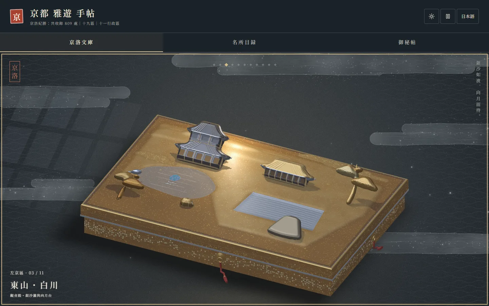
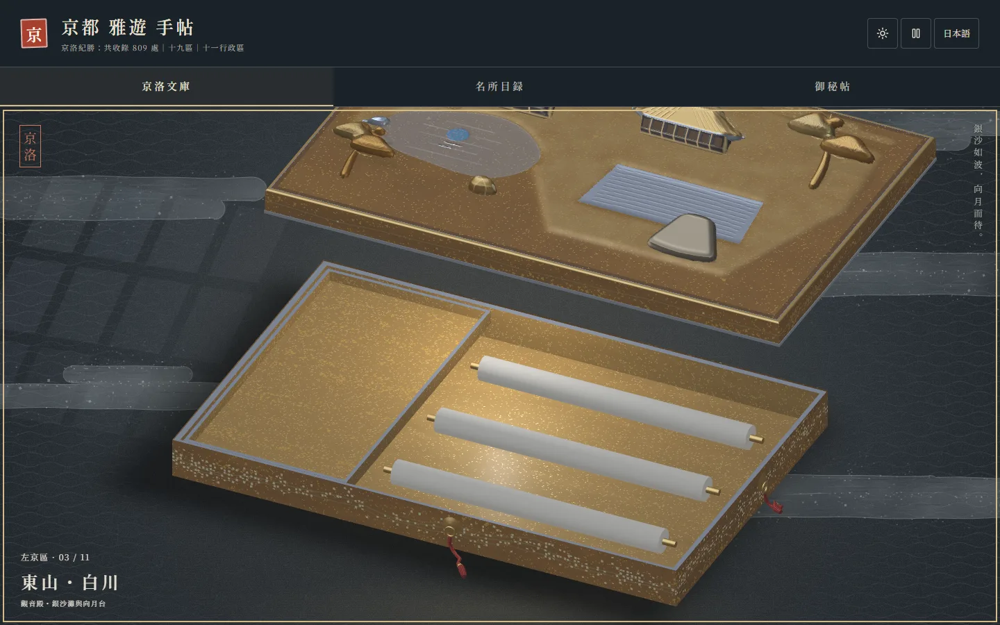
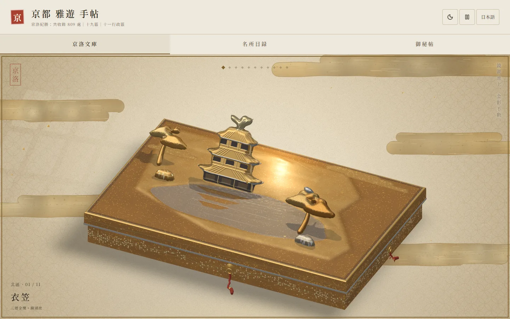
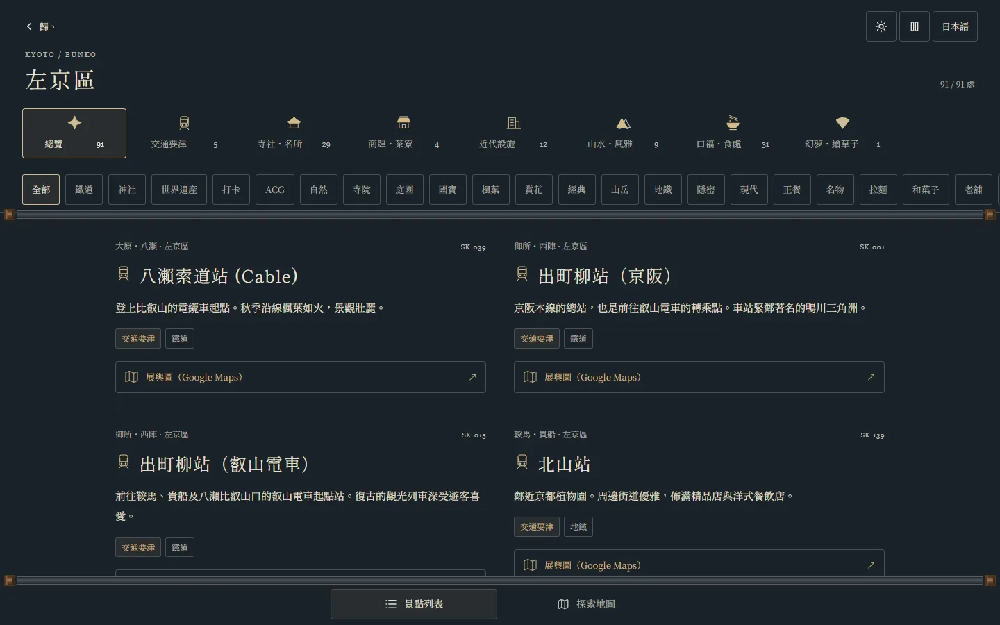
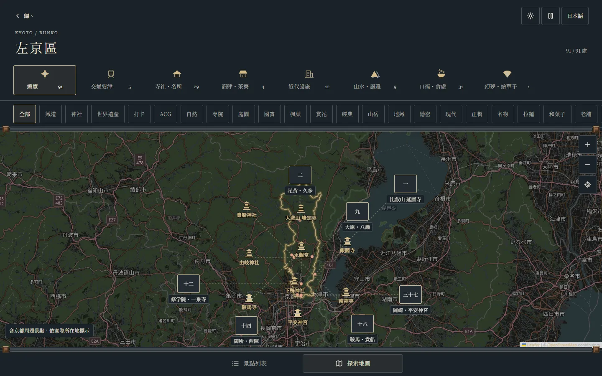
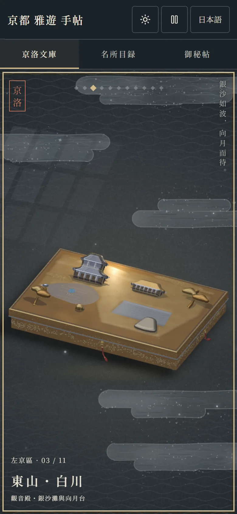
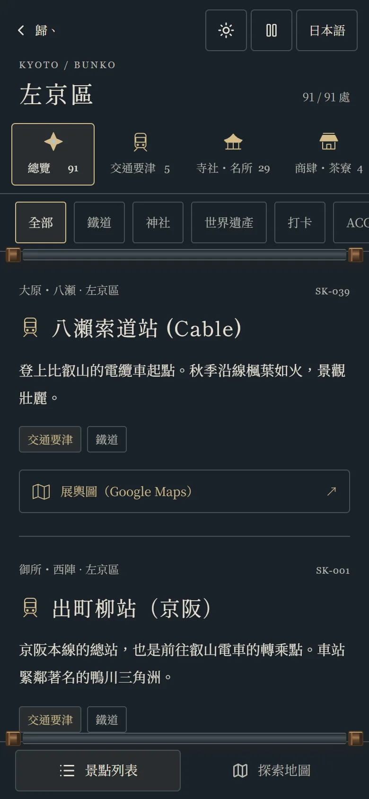

<div align="center">

# Kyoto Bunko 京洛文庫

**以漆器文箱收納的京都導覽：十一區、十一函、809 處。**

[English](README.md) · 繁體中文 · [日本語](README.ja.md)

[**開啟網站 →**](https://avalon-ash.github.io/Kyoto-Bunko/)



</div>

京洛文庫把京都的觀光索引做成一櫃漆器文箱。京都市十一個行政區各有一函，蓋面是該區名所的蒔繪浮雕，以 WebGL2 即時繪製。撫過盒面，金粉隨光流轉；左右拖動，換下一函；開蓋，就是這一區的名所之卷。

介面提供繁體中文與日文。

## 三種檢索

| | |
|---|---|
| **京洛文庫** | 一區一函。開蓋讀卷：依類型、標籤篩選，以卡片或地圖瀏覽。 |
| **名所目録** | 19 個散策區域（嵐山、祇園・清水、金閣寺周邊⋯），比行政區更細，適合排一日行程。 |
| **御秘帖** | 跨區的主題索引：抹茶、拉麵、世界遺產、紅葉、隱密老舖、ACG 聖地巡禮。 |

每個景點都能一鍵開啟 Google Maps。

<table>
<tr>
<td width="50%"></td>
<td width="50%"></td>
</tr>
<tr>
<td>開蓋</td>
<td>暖日主題・北區金閣</td>
</tr>
<tr>
<td></td>
<td></td>
</tr>
<tr>
<td>區卷：類型 → 標籤 → 卡片</td>
<td>同一批名所的地圖</td>
</tr>
</table>

<p align="center">

&nbsp;

</p>

## 特色

- **十一函蒔繪。** 每一函的蓋面都是逐區構圖的浮雕：認得出的大形做成立體，細節用平嵌的切金、切銀與青貝表現。光跟著手指或滑鼠走，部品隨光立起。
- **月光／暖日兩種主題**、語系切換；減少動態時部品全部躺平，光仍跟手。
- **809 處名所**，分七類：交通要津、寺社名所、商肆茶寮、近代設施、山水風雅、口福食處、幻夢繪草子（ACG）。食處新增或修改時以 Tabelog 查核。
- **手機優先。** 單指撫光、左右滑動換函、雙指放大，也能全程用鍵盤（方向鍵、Enter、`+`／`−`）。

## 本機執行

```bash
npm install
npm run dev        # http://127.0.0.1:3000
```

CI 每次部署前跑的檢查：

```bash
npm run lint && npx --no-install tsx validate_data.js --strict && npm test && npm run build
```

技術：React 19、Vite、TypeScript、Tailwind CSS 4、Leaflet、原生 WebGL2，不用 3D 引擎。

## 參與開發

- [開發文件](docs/DEVELOPMENT.md)：架構、資料 schema、標籤登記與資料錄入規範
- [目前狀態與交接](docs/HANDOFF.md)
- [代理執行合約](AGENTS.md)

## 致謝

行政區界與地圖圖磚 © [OpenStreetMap](https://www.openstreetmap.org/copyright) contributors（ODbL 1.0）。字體：Shippori Mincho B1、Noto Serif TC、Noto Serif JP（Google Fonts）。

文箱是寫意的蒔繪構圖，不是精確的建築復原或導航圖。
